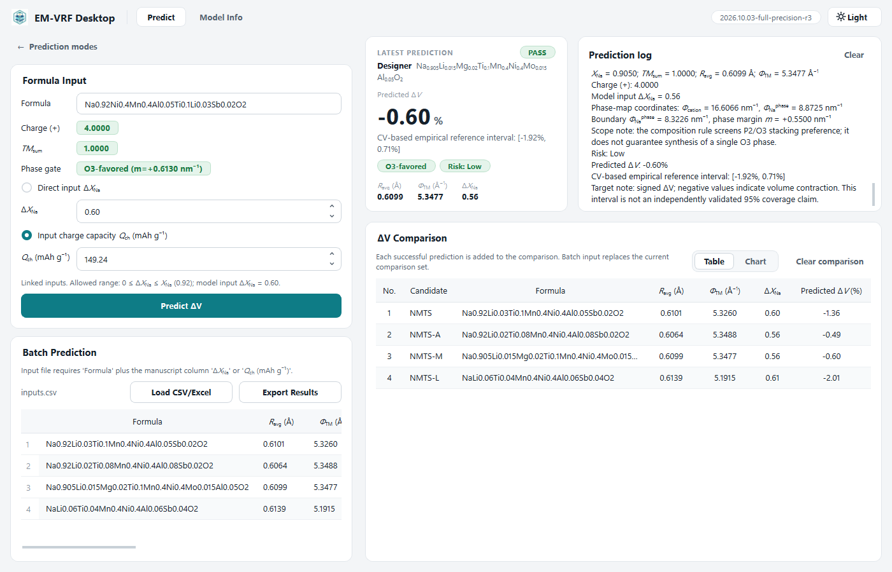

# EM-VRF Desktop

EM-VRF Desktop (Mechanism-Informed Electrochemical‐Mechanical Volume-Response Framework) is a graphical prediction tool for O3-type layered sodium-ion battery cathodes. Its support vector regression model predicts the relative unit-cell volume change during charging (ΔV) using the composition-weighted average ionic radius of the transition-metal layer (R_avg), ionic potential (Φ_TM), and Na-extraction amount (ΔX_Na). Users can specify compositions through chemical-formula entry or element-based design and provide ΔX_Na directly or calculate it from the specific charge capacity. Excel/CSV batch import and result export are also supported. Predictions are generated only for candidates that pass the input checks and are classified as O3-favored by the composition-based criterion. Negative ΔV indicates unit-cell contraction, with smaller |ΔV| representing a weaker contraction response.



## Download the Windows application

The ready-to-run application for 64-bit Windows 10 or 11 is attached to this repository's Releases as `EM-VRF-Desktop-2026.10.09-win64.zip`. Extract it, keep the `_internal` folder next to `EM-VRF Desktop.exe` and run the executable; no installation or Python environment is needed.

## Run from source

Python 3.10 with the pinned packages in `requirements.txt` (the versions bundled in the release):

```bash
python -m pip install -r requirements.txt
python main.py
```

Command-line use:

```bash
python main.py --self-test
python main.py --predict "Na0.92Ni0.4Mn0.4Al0.05Ti0.1Li0.03Sb0.02O2" --qch 149.24
python main.py --predict "Na0.92Ni0.4Mn0.4Al0.05Ti0.1Li0.03Sb0.02O2" --delta-x-na 0.60 --output-json result.json
```

`--self-test` checks four reference compositions, the Ce correction, the input guards and the phase gate and prints a JSON report (`"passed": true`). `--predict` prints the descriptors, phase-screening result and predicted ΔV as JSON (`--output-json` writes it to a file instead).

## Reproduce the model

```bash
python train_model.py
python train_model.py --full-validation
```

`train_model.py` refits StandardScaler + RBF-SVR (C = 3, ε = 0.001, γ = "scale") on the 45 records in `data/Supplementary Table 5.xlsx` (R_avg and Φ_TM from the table; ΔX_Na recalculated from the formula and Q_ch) and repeats the 20 × 5 cross-validation (seed 20260912). It stops with an error unless the refitted model reproduces the shipped `data/EM-VRF-ΔV.pkl` and the metrics in `data/model_meta.json`. `--full-validation` adds the nested 10 × 5 cross-validation and the seed-sensitivity runs. Results are written to `results/retrained`; `data/` is never modified. The reference output is in `docs/verification/`.

## Verify that the executable is built from this source

With Python 3.10:

```bash
python tools/build_exe.py verify "path/to/EM-VRF Desktop.exe"
```

This compiles `main.py` and checks that it is identical to the program embedded in the executable. `tools/build_exe.py build` embeds `main.py` into a released executable's PyInstaller runtime.

## Repository contents

| Path | Contents |
| --- | --- |
| `main.py` | Complete application source, in sections: original application, 2026-10-03 full-precision revision, 2026-10-08 numeric-step fix, 2026-10-09 interface |
| `train_model.py` | Model reproduction and validation from Supplementary Table 5 |
| `requirements.txt` | Pinned Python packages |
| `data/` | Fitted model (`EM-VRF-ΔV.pkl`), model metadata, training-domain ranges, training-population record, element table and `Supplementary Table 5.xlsx` (the 45 literature records used for model development) |
| `assets/` | Application icon |
| `examples/Example.xlsx` | Example batch-prediction input |
| `tools/` | Build and verification tool for the executable |
| `precision_revision/` | Records of the 2026-10-03 full-precision and Ce⁴⁺ ionic-radius revision |
| `docs/CHANGES.md` | Revision history |
| `docs/verification/` | Source/build, training-reproduction, numeric-step and data-file records |
| `docs/screenshots/` | Interface screenshots |

## Notes

The SHA-256 of `Supplementary Table 5.xlsx` recorded in `data/model_meta.json` and `precision_revision/` refers to the workbook before its Excel document properties were cleaned for publication; the cell data are identical (see `docs/verification/DATA_FILE_CHANGES.json`).

## License

MIT; see `LICENSE`. The release's `_internal` folder contains the Python 3.10 runtime and third-party libraries (Qt for Python/PySide6, NumPy, SciPy, pandas, scikit-learn, openpyxl and their dependencies), which remain under their own licenses.
